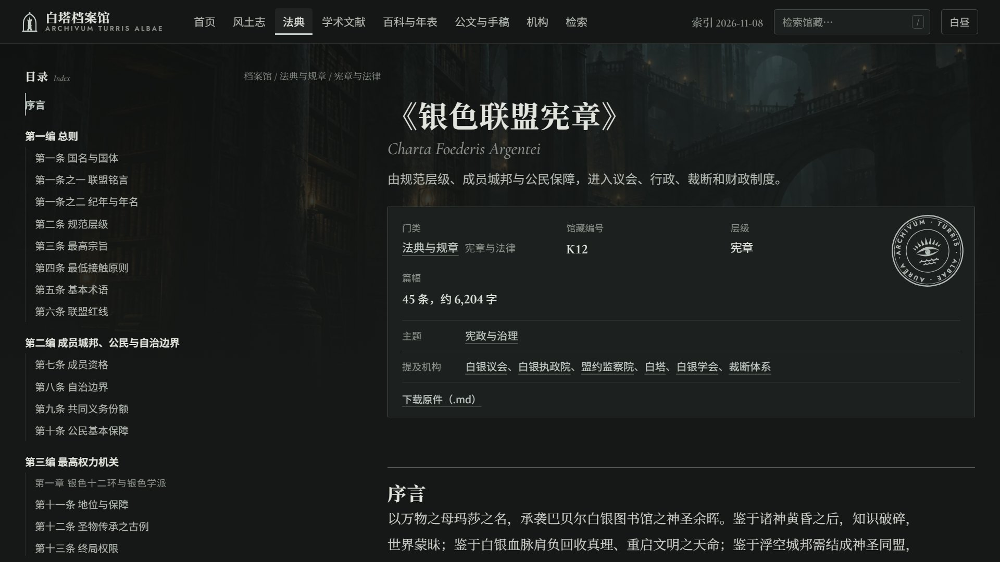
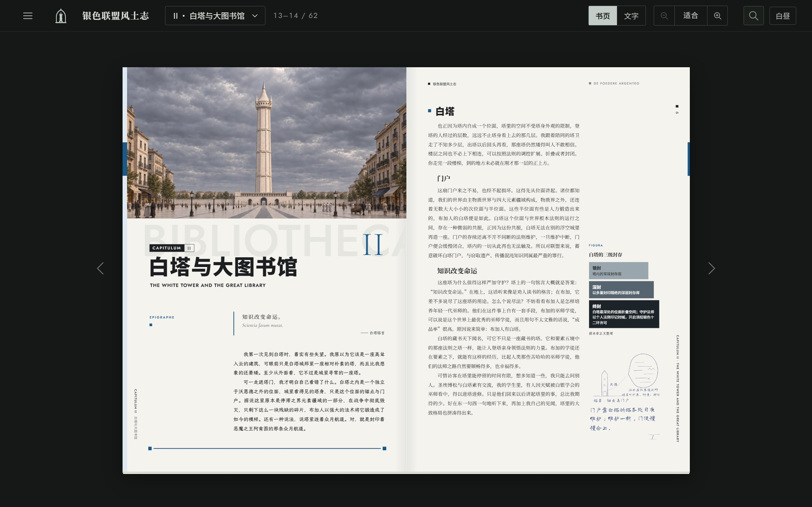

# 白塔档案馆

**银色联盟的法典、文献与档案，可以检索，也可以连续阅读。**

[在线阅读](https://gyjdb.github.io/buga-setting/) · [法典与规章](https://gyjdb.github.io/buga-setting/#/canon) · [学术文献](https://gyjdb.github.io/buga-setting/#/scholarship) · [百科与年表](https://gyjdb.github.io/buga-setting/#/encyclopaedia) · [公文与手稿](https://gyjdb.github.io/buga-setting/#/records) · [银色联盟风土志](https://gyjdb.github.io/buga-setting/#/guide) · [报告问题](https://github.com/gyjdb/buga-setting/issues)

白塔档案馆收藏银色联盟的世界内文献，分为四个门类：法典与规章、学术文献、百科与年表、公文与手稿。你可以从《银色联盟宪章》读起，沿着法律、机构与学术制度继续查阅；也可以先读馆藏读物《银色联盟风土志》，一本带插图、以游记口吻写成的布加导读；或者翻开《联盟学术名篇》，看这个世界的学者怎样写论文。

本项目是基于《琥珀之剑》的**非官方衍生整理与创作**，包含个人扩写及经作者筛选、修改的 AI 辅助文本与插图，不代表原作官方设定。网站中的“现行”指本项目自己的设定状态。


## 从哪里开始

- **第一次来**：先读[《银色联盟风土志》](https://gyjdb.github.io/buga-setting/#/guide)对布加有个整体印象，再从首页的四个门类进入；法典从《银色联盟宪章》开始。
- **查一个概念**：使用全站检索，可按门类、主题与机构筛选，按门类顺序、相关度或标题排序，结果显示匹配片段。
- **读一份文献**：卷首的著录卡列出门类与分组、馆藏编号、层级或发布者与年代、主题与提及的机构，并给原件下载；目录定位章节，文中的《书名》和“第N条”悬停即看原文，文末著录列原件与 SHA-256。
- **看学问**：[学术文献](https://gyjdb.github.io/buga-setting/#/scholarship)收《联盟学术名篇》的二十篇论文，以及学科评定、院校排行与期刊年报。名篇的[目录](https://gyjdb.github.io/buga-setting/#/papers)可以检索篇名、作者与刊物，按学科筛选；每篇有题解、著录与中英文版本。
- **查机构**：[机构总目](https://gyjdb.github.io/buga-setting/#/institutions)列出现行机构的职责与有依据的组织关系。



## 馆藏读物：《银色联盟风土志》

写给初次接触布加的地上读者。克鲁兹帝国圣埃博松学院的学者罗恩·萨米利安以第一人称记下他在浮空城邦的所见所闻，九章从“天上的国度”写到“岁时”；卷首是他的朋友图拉曼·秘银·奥瑟坦的手写序，书页间还有图拉曼的批注。



- **两种显示**，顶栏“书页 / 文字”随时切换，选择保存在本机：
  - **书页版**是插图本：按 210 × 299.5 mm 的实体书页和 10pt 正文排版，章首图、插图、批注、资料卡与图注都有固定位置，整页随窗口缩放。想看清细节可以放大：顶栏按钮、`+` `−` `0` 键、Ctrl + 滚轮或双击书页，放大后拖动书页平移。
  - **文字版**是手机和小窗口的默认：正文 15px，按窗口重新分页，插图和批注插在对应段落之后。
- 宽屏对开、窄屏单页；用书页两侧的箭头、← →、PageUp / PageDown 或触屏横滑翻页。阅读位置按段落保存在本机浏览器，两种显示共用。
- 目录底部的“完整正文与著录”显示不分页的全文与馆藏著录。阅读时站内导航收进顶栏左端的按钮。

**事实边界。** 书中所述制度以现行法典为准。叙述者的见闻与判断、图拉曼的评价与玩笑是书里的声音，不是新增设定，也不作为其他文献的依据。

插图包括 AI 辅助生成的概念演绎，以及维护者绘制的四季水彩和批注草图；它们不构成已确认的建筑式样、徽记、器物或历史事件，图注只照录或节录正文。制作方式与逐类说明见[插图来源](tools/library_portal/web/assets/SOURCES.md)。

## 馆藏读物：《联盟学术名篇》

恰恩大学出版部编的一部选本，第一纪三百七十五年修订本：收联盟学问史上改变了一门学问问法的二十篇论文，从混沌纪年 824 年塞弗林的《二十四问》到第一纪 360 年卡明斯的《推演机与领悟》，以发表先后为序。每篇前有编者的题解，后附一篇相关的短文。

- **中译本合订一册**（[联盟学术名篇.pdf](organized_project/08_CLASSIC_PAPERS/联盟学术名篇.pdf)）：书名页、编选说明、目录与二十篇，页码连续，PDF 书签按混沌纪年、第一纪分组。
- **英文原刊二十份**（[原刊](organized_project/08_CLASSIC_PAPERS/原刊/)）：各照原作当年所在的刊物排印，前附单行本封面与刊徽，页码照原刊；文件名前的序号即篇次。
- **在线阅读**：[学术文献](https://gyjdb.github.io/buga-setting/#/scholarship)页的“学术名篇”一组与[目录](https://gyjdb.github.io/buga-setting/#/papers)列出二十篇，点篇名进入该篇的详情页，列题解、著录与阅读版本。[《元素亲和表》](https://gyjdb.github.io/buga-setting/#/paper-read/metcalfe)、[《论质数的疏密》](https://gyjdb.github.io/buga-setting/#/paper-read/alding)、[《复工、收贴与银券通论》](https://gyjdb.github.io/buga-setting/#/paper-read/stanhope)三篇另有中英文网页全文，带章节目录、公式与图版，手机上也能读；其余十七篇读 PDF。[合订本](https://gyjdb.github.io/buga-setting/#/doc/5d32e64132b3cb692ad4)在宽屏的文献页内嵌浏览器自带的 PDF 阅读器，手机与触屏给打开与下载的链接。篇次、出处、合订本页码与各批中译稿见[篇目](https://gyjdb.github.io/buga-setting/#/doc/a30a4d0ae80a78bf2b25)。

**事实边界。** 论文只借现实名篇的论证骨架与写法，内容、概念与文字都是这个世界的；题解与附文里新定的设定经作者逐批认可。中译与英文原刊的源稿在 `organized_project/08_CLASSIC_PAPERS/各批/`，按批合卷，网站的学术文献页在构建时从这里截取正文；排印本与源稿的文字相同。PDF 不进全文检索，检索源稿即可找到对应的文字。

## 门类与著录

| 门类 | 分组 |
| --- | --- |
| 法典与规章 *Leges et Statuta* | 宪章与法律 · 组织与规程 · 部院办法与学界通则 |
| 学术文献 *Acta et Periodica* | 学术名篇 · 评定与荣誉 · 期刊与年报 |
| 百科与年表 *Encyclopaedia et Annales* | 风土志 · 《联盟百科全书》 · 年表与年名 |
| 公文与手稿 *Acta et Manuscripta* | 公文与决定 · 讲演与手稿 |

法典按宪章第二条的规范层级排列，其余门类按文献的性质分组。现行法典沿用法典编号（如宪章 `K12`）；其余馆藏文书按门类编号（法典与规章 `LS`、学术文献 `AP`、百科与年表 `EA`、公文与手稿 `AM`），著录发布者与世界内的年代。年代用世界内的纪年；项目日期与文件修改时间不是世界内的颁布日期。门类与分组定在 `tools/library_portal/data/categories.json`。

主题和机构筛选用于查找文本提及，不推断机构隶属。[机构总目](https://gyjdb.github.io/buga-setting/#/institutions)另以结构化实体展示职责及有明确依据的组织关系，支持名称／别名搜索、下属单位展开、历史状态与设施入口。详情区分设立规范依据、历史描述与全文提及；分组不自动表示隶属。没有定位到的原文引用如实标注，不用近似名称补造来源。

名录数据维护于 `tools/library_portal/data/institutions.json`；每个实体及关系保留文件、条款、原文与行号。构建检查唯一 ID、有效目标、来源定位、现行清单一致和上下级无环。覆盖范围及资料边界见 [机构名录说明](docs/INSTITUTIONS.md)。

## 技术与本地运行

这是纯静态网站：Python 在构建时生成 Markdown 正文、JSON 索引与原件副本，浏览器用原生 JavaScript 和 Web Worker 完成搜索、筛选和阅读。**GitHub Pages 可以完整承载，不需要数据库、在线 Python 服务或账号登录。**

需要 Python 3.10+；Node.js 仅用于运行搜索与前端检查。

```bash
git clone https://github.com/gyjdb/buga-setting.git
cd buga-setting
python -m pip install -r tools/library_portal/requirements.txt
python tools/library_portal/fetch_fonts.py
python tools/library_portal/build.py
python tools/library_portal/verify.py
python tools/library_portal/verify_publication.py
python -m http.server 8765 --bind 127.0.0.1 --directory site/library_portal
```

打开 [本地预览：127.0.0.1:8765](http://127.0.0.1:8765/)。不要双击 `index.html`，`file://` 无法正常读取索引和启动搜索 Worker。

首次准备需要联网安装依赖及获取字体。字体按固定版本下载并核验 SHA256，构建后随站点提供；访客不访问字体 CDN，也不依赖电脑已安装字体。准备完成后可离线重建和通过本地 HTTP 服务阅读，也可将整个 `site/library_portal/` 复制到另一台电脑使用。

### 检查与更新

```bash
python tools/library_portal/build.py
python tools/library_portal/verify.py
python tools/library_portal/verify_publication.py
node tools/library_portal/test_search.cjs
node tools/library_portal/test_frontend.cjs
python -m unittest discover -s tools/library_portal -p test_institutions.py
node tools/library_portal/test_institutions.cjs
node tools/library_portal/test_institution_detail.cjs
python -m unittest discover -s tools/library_portal -p test_papers.py
node tools/library_portal/test_papers.cjs
```

构建只写入 `site/library_portal/`，不编辑 `organized_project/`。检查覆盖原件哈希、现行清单、索引完整性、内部链接、正文安全渲染和搜索行为；不代替世界观内容的人工审查。

修改前端后重建即可。馆藏由维护者的本地工作区同步而来，文书经作者认可后才入藏；`docs/public-source-manifest.json` 记录公开快照的原始字节哈希，检查会拒绝未登记的变化。

## GitHub Pages 部署

仓库自带[发布工作流](.github/workflows/pages.yml)。仓库所有者首次在 **Settings → Pages → Build and deployment → Source** 选择 **GitHub Actions**；之后推送 `main` 会构建、检查并发布到：

[白塔档案馆 · 在线阅读](https://gyjdb.github.io/buga-setting/)

Pull Request 只执行检查，不发布。部署产物只有生成站点，不包含工作目录、Git 历史或本地运行脚本。页面使用 `#/…` 路由和相对资源路径，支持 GitHub 项目子目录；分享文献链接后可直接打开，也可刷新。

首次启用后如需重新发布，在 **Actions → Build and publish archive → Run workflow** 手动运行。应同时确认 Actions 部署成功与实际网址可访问。

## 仓库结构与公开范围

```text
organized_project/          # 馆藏文献
  01_CURRENT_CANON/        # 现行法典：宪章、法律与实施规范
  07_WORLD_GUIDE/          # 《银色联盟风土志》正文与序
  08_CLASSIC_PAPERS/       # 《联盟学术名篇》：各批中译与英文原刊的源稿、PDF 与篇目
  09_HOLDINGS/             # 其余馆藏文书，按四个门类分目录
tools/library_portal/       # 只读构建器、校验与搜索测试
  web/                     # 正式前端、场景、定稿 SVG 图标与字体许可
    index.html, portal*.*  # 档案馆外壳：首页、门类页、文献页、机构总目与检索
    book*.js, book*.css    # 风土志阅读器：书页版与文字版的排版、手写与注释字体切片
    book-plan.json         # 风土志插图、批注与资料卡的版面位置
    papers.js, papers.css  # 学术文献：目录、详情页与网页全文
    assets/plates/         # 风土志插图（WebP）及 manifest.json
    assets/papers/         # 三篇网页全文的公式与图版（预生成的 SVG）及来源说明
  papers.py                # 构建时从源稿截取论文正文，生成目录与双语正文
  data/categories.json     # 馆藏门类与分组
  data/canon.json          # 现行法典的路径与哈希，公开构建据此选定现行正文
  data/papers.json         # 学术文献的篇目登记表
  fetch_fonts.py           # 固定来源、SHA256 校验的字体准备
docs/                      # 公开范围、来源清单、项目截图
.github/workflows/pages.yml # 构建、检查与 Pages 发布
site/library_portal/       # 本地生成结果，不提交到 Git
```

公开版只收馆藏。作者决定、提案、法典旧版、底稿、编校与审计记录和原始资料只在维护者本地，不随仓库发布；原始聊天导出、账号与项目容器元数据、工具缓存、第三方技能、旧设计样板和历史门户代码快照也未发布。

详细范围见 [PUBLICATION.md](docs/PUBLICATION.md)。数量由当前构建数据计算，不在介绍中维护容易过期的手填计数。

## 视觉、字体与许可

页面默认是“石室”暗色：石构藏书空间、深色装帧与哑银，烛光色只作焦点与改动的提示；顶栏“白昼”换成纸本阅读模式。场景图与风土志插图是 AI 辅助创作的概念演绎，不证明世界内存在对应建筑、徽章或历史事件；没有搬用参考网站的角色、标志或场景。馆标采用作者提供的定稿 B 组 SVG。

| 角色 | 字体与真实字重 |
| --- | --- |
| 中文馆名、文献题名 | 思源宋体 SC（Noto Serif SC），700 |
| 中文长篇正文 | 思源宋体 SC（Noto Serif SC），400 |
| 导航、按钮、目录、资料字段 | 思源黑体 SC（Noto Sans SC），400 / 500 / 600 |
| 拉丁文副题与数字 | Cormorant Garamond，500 / 600，副题用斜体 |
| 馆藏章上的字 | Jost，600 |

《银色联盟风土志》的正文与题记同样是思源宋体，章名、小标题与标签是思源黑体；书里还用到下面几款字体，其中 Cormorant Garamond 与 Jost 也用在档案馆的拉丁文副题、数字和馆藏章上：

| 角色 | 字体 |
| --- | --- |
| 章首导语、图注、题记署名，资料卡与图示的说明文字 | 霞鹜文楷屏幕阅读版（LXGW WenKai Screen），400 |
| 图拉曼的序与批注 | 龙藏体（Long Cang），400 |
| 书页上的拉丁文与英文 | Cormorant Garamond，可变字重；标签用 Jost |

字体来源、固定版本与哈希见 [SOURCES.json](tools/library_portal/web/fonts/SOURCES.json)。中文字体使用真实可变字重，禁用伪粗体。思源宋体、思源黑体用的是 Google 版（Noto Serif SC / Noto Sans SC），与龙藏体、霞鹜文楷一样按 Unicode 范围切片，浏览器只下载页面用到的部分；两个家族另有一个从原字体文件切出的标点片（`tools/library_portal/web/assets/fonts/`），引号和句读在同一个文件里，相邻标点照常挤压。

项目代码、原创界面与维护者有权授权的原创材料采用 **[MIT License](LICENSE)**。思源宋体（Noto Serif SC）、思源黑体（Noto Sans SC），以及风土志与档案馆拉丁文用的 Cormorant Garamond、Jost、龙藏体与霞鹜文楷屏幕阅读版保留 **SIL Open Font License 1.1**，详见 [THIRD_PARTY_NOTICES.md](THIRD_PARTY_NOTICES.md)。

《琥珀之剑》及其原作名称、人物、组织、术语和世界观元素的权利仍归原作者或相应权利人；MIT 不将这些第三方内容重新授权。本项目供非官方整理、交流与创作讨论使用。

## 反馈与贡献

欢迎提交 Issue，附上页面链接、预期与实际表现。文字或设定建议请说明依据及影响范围；未获作者确认的建议不会入藏。前端贡献请运行上述检查，并检查手机阅读、键盘焦点与原件下载。

维护者：**Ethan / [gyjdb](https://github.com/gyjdb)**。
